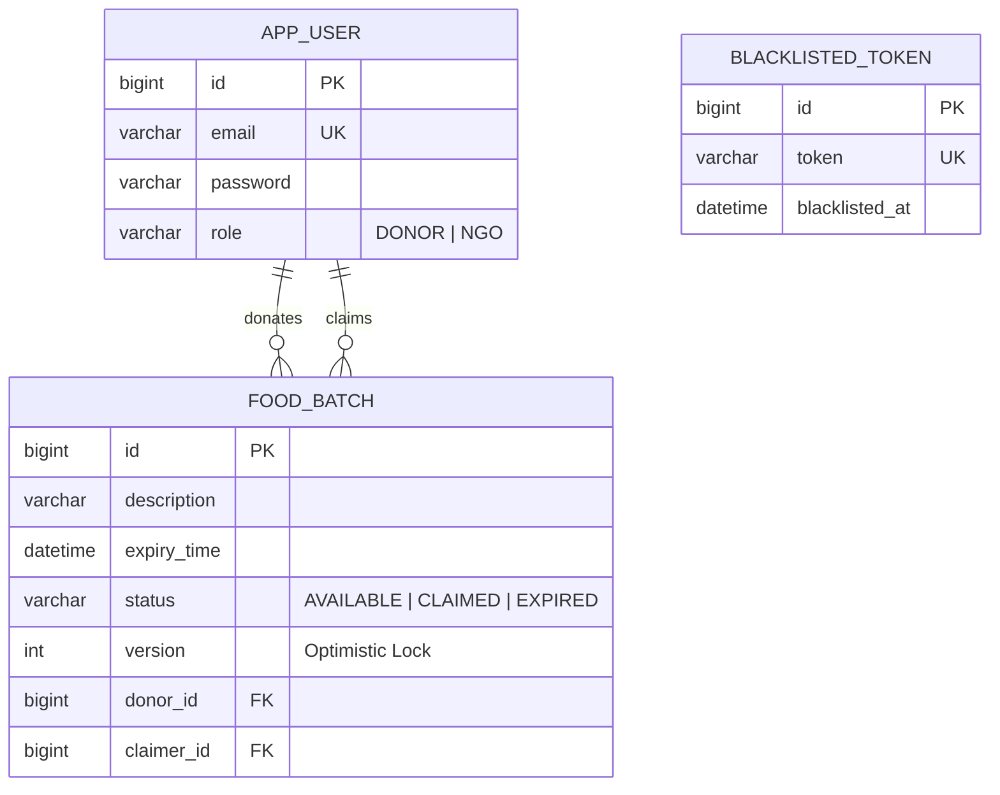

# ResQMeal 🚀

[](https://www.oracle.com/java/)
[](https://spring.io/projects/spring-boot)
[](https://www.mysql.com/)
[](https://jwt.io/)
[](LICENSE)

> **Connecting surplus food with communities that need it.**  
> A high-performance, concurrent REST API backend connecting food donors (restaurants, caterers, bakeries) with NGOs and shelters in real-time.

🔗 **Backend Repository:** [https://github.com/anupamchaubey/ResQMeal.git](https://github.com/anupamchaubey/ResQMeal.git)  
🎨 **Frontend Repository:** [https://github.com/anupamchaubey/resqmeal-frontend](https://github.com/anupamchaubey/resqmeal-frontend)

---

## 📌 Table of Contents

- [System Architecture](#-system-architecture)
- [Tech Stack](#-tech-stack)
- [Key Engineering Highlights](#-key-engineering-highlights)
- [Database Schema & ERD](#-database-schema--erd)
- [API Reference](#-api-reference)
- [Getting Started](#-getting-started)
- [Environment Configuration](#-environment-configuration)
- [Testing Endpoints with cURL](#-testing-endpoints-with-curl)
- [Frontend Companion](#-frontend-companion)
- [License](#-license)

---

## 🏗 System Architecture

```text
                  +--------------------------------+
                  |  Frontend / API Clients (React)|
                  +--------------------------------+
                                  |
                                  | HTTP (Bearer JWT)
                                  v
                  +--------------------------------+
                  |   Spring Boot REST Controllers |
                  |   - AuthController             |
                  |   - FoodController             |
                  +--------------------------------+
                                  |
            +---------------------+---------------------+
            |                     |                     |
            v                     v                     v
    +---------------+    +------------------+    +---------------+
    |   JwtFilter   |    |   FoodService    |    |  FoodSweeper  |
    |  & Security   |    | (Optimistic Lock)|    | (@Scheduled)  |
    +---------------+    +------------------+    +---------------+
            |                     |                     |
            +---------------------+---------------------+
                                  |
                                  v
                  +--------------------------------+
                  |    Spring Data JPA / Hibernate |
                  +--------------------------------+
                                  |
                                  v
                  +--------------------------------+
                  |           MySQL DB             |
                  |  - app_user                    |
                  |  - food_batch                  |
                  |  - blacklisted_token           |
                  +--------------------------------+
```

---

## ⚙️ Tech Stack

| Component | Technology | Description |
|---|---|---|
| **Language** | Java 21 (LTS) | Modern Java features, records, pattern matching |
| **Framework** | Spring Boot 3 | Web MVC, Security, Scheduling |
| **ORM / Persistence** | Spring Data JPA / Hibernate | Relational mapping, optimistic locking |
| **Database** | MySQL 8+ | Relational data persistence, foreign key enforcement |
| **Security** | Spring Security, BCrypt | Stateless authorization, password hashing |
| **Authentication** | JSON Web Tokens (`jjwt 0.11.5`) | HMAC-SHA256 stateless token passes |
| **Concurrency** | JPA Optimistic Locking (`@Version`) | Double-booking prevention on food claims |
| **Background Jobs** | Spring `@Scheduled` | Automated inventory expiration sweeper |
| **Build Tool** | Apache Maven | Dependency management and build packaging |

---

## 🧠 Key Engineering Highlights

### 1. Concurrency Control & Race Condition Prevention
When multiple NGOs attempt to claim the exact same food batch simultaneously, traditional locking can lead to double allocation. ResQMeal leverages **JPA Optimistic Locking (`@Version`)** on `FoodBatch`:
- Hibernate automatically inspects the row version during `UPDATE`.
- If another transaction modified the row in the same millisecond, Hibernate throws an `OptimisticLockException`, rejecting duplicate claims.

### 2. Stateless JWT with Token Blacklist Invalidation
Standard JWTs remain valid until their expiration timestamp. ResQMeal combines stateless JWT verification with an active **Token Blacklist**:
- On logout (`POST /api/auth/logout`), the token signature is persisted into `blacklisted_token`.
- Every incoming request evaluated by `JwtFilter` checks `TokenBlacklistRepository.existsByToken(token)`.
- If blacklisted, the request is immediately rejected (HTTP 403), providing instantaneous session revocation without maintaining stateful sessions.

### 3. Automated Lifecycle Sweeper (`@Scheduled`)
A background worker (`FoodSweeper.java`) executes every 60 seconds (`@Scheduled(fixedRate = 60000)`):
- Identifies all `AVAILABLE` food batches where `expiryTime < LocalDateTime.now()`.
- Automatically transitions them to `EXPIRED`.
- Ensures NGOs never see stale or unsafe food batches without requiring manual database cleanup.

### 4. Relational Data Integrity & Auditing
- Strict `@ManyToOne` constraints bind every food batch to an authenticated donor (`donor_id`).
- Upon claiming, the shelter identity is atomically attached (`claimer_id`).
- Food cannot be deleted by unauthorized users or once an NGO has already claimed it for pickup.

---

## 🗄 Database Schema & ERD



---

## 🔌 API Reference

### 1. Authentication Endpoints (`/api/auth`)

| Method | Endpoint | Description | Auth Required | Request Body |
|---|---|---|:---:|---|
| `POST` | `/api/auth/register` | Register a new user (`DONOR` or `NGO`) | No | `{"email": "...", "password": "...", "role": "DONOR"}` |
| `POST` | `/api/auth/login` | Authenticate and obtain JWT pass | No | `{"email": "...", "password": "..."}` |
| `POST` | `/api/auth/logout` | Invalidate active token via Blacklist | Bearer Token | *(None)* |

### 2. Food Management Endpoints (`/api/food`)

| Method | Endpoint | Description | Auth Required | Role |
|---|---|---|:---:|:---:|
| `GET` | `/api/food/available` | List all unexpired, available food | Bearer Token | `NGO` / `DONOR` |
| `PUT` | `/api/food/{id}/claim` | Claim an available food batch | Bearer Token | `NGO` |
| `GET` | `/api/food/my-claims` | View past claimed batches | Bearer Token | `NGO` |
| `POST` | `/api/food` | Post surplus food with expiration | Bearer Token | `DONOR` |
| `GET` | `/api/food/my-posts` | View donor's posted food history | Bearer Token | `DONOR` |
| `DELETE` | `/api/food/{id}` | Delete an unclaimed post | Bearer Token | `DONOR` |

---

## 🚀 Getting Started

### Prerequisites

- **Java JDK 21** or later installed (`java -version`)
- **MySQL 8.0+** running locally or remotely
- **Maven 3.9+** (or use the included `./mvnw` wrapper)

### Step 1: Clone the Repository

```bash
git clone https://github.com/anupamchaubey/ResQMeal.git
cd ResQMeal
```

### Step 2: Set Up MySQL Database

Log into MySQL and create the database:

```sql
CREATE DATABASE resqmail_db;
```

### Step 3: Configure Database Credentials

Open `src/main/resources/application.properties` and verify your credentials:

```properties
spring.application.name=ResQMeal

# Database Connection
spring.datasource.url=jdbc:mysql://localhost:3306/resqmail_db
spring.datasource.username=root
spring.datasource.password=root

# JPA / Hibernate
spring.jpa.show-sql=true
spring.jpa.hibernate.ddl-auto=update
```

### Step 4: Build and Run

Using Maven Wrapper:

```bash
# On Linux / macOS
./mvnw clean spring-boot:run

# On Windows
.\mvnw.cmd clean spring-boot:run
```

The server starts on port `8080` by default: `http://localhost:8080`.

---

## 🧪 Testing Endpoints with cURL

### 1. Register a Donor

```bash
curl -X POST http://localhost:8080/api/auth/register \
  -H "Content-Type: application/json" \
  -d '{
    "email": "donor@bakery.com",
    "password": "password123",
    "role": "DONOR"
  }'
```

### 2. Login to get JWT Token

```bash
curl -X POST http://localhost:8080/api/auth/login \
  -H "Content-Type: application/json" \
  -d '{
    "email": "donor@bakery.com",
    "password": "password123"
  }'
```
*Response: Plain-text JWT token (e.g. `eyJhbGciOi...`)*

### 3. Post Surplus Food (Donor)

```bash
curl -X POST http://localhost:8080/api/food \
  -H "Content-Type: application/json" \
  -H "Authorization: Bearer <YOUR_JWT_TOKEN>" \
  -d '{
    "description": "50 Fresh Loaves of Sourdough Bread | Location: 4th Ave",
    "expiryTime": "2026-10-02T22:00:00"
  }'
```

### 4. Discover Available Food (NGO)

```bash
curl -X GET http://localhost:8080/api/food/available \
  -H "Authorization: Bearer <YOUR_JWT_TOKEN>"
```

### 5. Claim Food (NGO)

```bash
curl -X PUT http://localhost:8080/api/food/1/claim \
  -H "Authorization: Bearer <YOUR_JWT_TOKEN>"
```

### 6. Logout & Invalidate Token

```bash
curl -X POST http://localhost:8080/api/auth/logout \
  -H "Authorization: Bearer <YOUR_JWT_TOKEN>"
```

---

## 💻 Frontend Companion

A companion React + JavaScript frontend designed specifically for ResQMeal is available at:  
👉 **[https://github.com/anupamchaubey/resqmeal-frontend](https://github.com/anupamchaubey/resqmeal-frontend)**

It features:
- **Responsive Role-Based Dashboards**: Tailored views for `DONOR` and `NGO` roles.
- **Real-Time Inventory & Concurrency**: Instant food claiming with automatic handling of JPA optimistic locking conflicts (HTTP 409).
- **Zero-CORS Dev Setup**: Built-in Vite proxy forwarding `/api` to `http://localhost:8080`.
- **Form Validation & Auto JWT**: Automatic Bearer token attachment and token blacklist logout.

To run the frontend:
```bash
git clone https://github.com/anupamchaubey/resqmeal-frontend.git
cd resqmeal-frontend
npm install
npm run dev
```

---

## 📄 License

This project is licensed under the [MIT License](LICENSE).